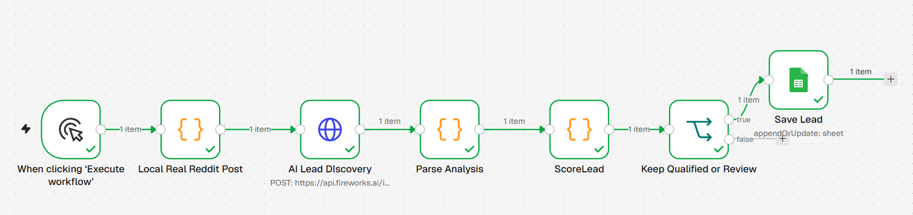

# AI Lead Qualification with n8n

An automation prototype that analyzes public posts for software
development buying intent, extracts project information, and assigns
a lead priority score.

## Technologies

- n8n
- Fireworks AI
- JavaScript
- Google Sheets
- Hacker News Search API

## Features

- Fetches and normalizes live Hacker News search results.
- Supports manually imported real public posts.
- Uses AI to extract buying intent, service category, requirements,
  budget information, and supporting evidence.
- Validates the AI response before scoring.
- Calculates a score using explicit JavaScript rules.
- Routes posts into qualified, manual-review, or rejected categories.
- Includes Google Sheets integration for accepted leads.

## Workflow

Post input → Normalize → AI analysis → Validate response →
Score lead → Conditional routing → Google Sheets

## Scoring

| Signal | Maximum points |
|---|---:|
| Explicit hiring intent | 30 |
| Service fit | 25 |
| Budget or willingness to pay | 20 |
| Clear requirements | 15 |
| Recency | 10 |

A score is a prioritization rule, not a probability of conversion.
Buyer and service-fit checks must also pass.

## Setup

1. Import lead-qualification-workflow.json into n8n.
2. Create a Fireworks Header Auth credential:
   - Header name: Authorization
   - Header value: Bearer YOUR_API_KEY
3. Select that credential in the analysis node.
4. Connect your own Google Sheets account and select your spreadsheet.
5. Check that Parse Analysis references the active input node.
6. Start with one post and run the workflow manually.

Never place API keys directly in the workflow JSON or repository.
Fireworks API usage may require credits.

## Current status and limitations

- Prototype under development.
- Live Hacker News collection has been tested, but tested results
  did not contain suitable buying requests.
- Reddit content is currently entered manually; automated Reddit
  collection is not implemented.
- Google Sheets authentication has been connected.
- Successful accepted-lead storage and repeat-run updates still
  require verification.
- Persistent duplicate checks before AI processing, scheduled runs,
  and complete failure handling are not yet implemented.
- No frontend is included.
- Hosted execution depends on an active n8n hosting arrangement.

## Validation

Real public discussion posts were analyzed and routed to the
rejected branch when they contained no buying intent.

## Files

- lead-qualification-workflow.json — sanitized n8n workflow export
## Workflow screenshot

